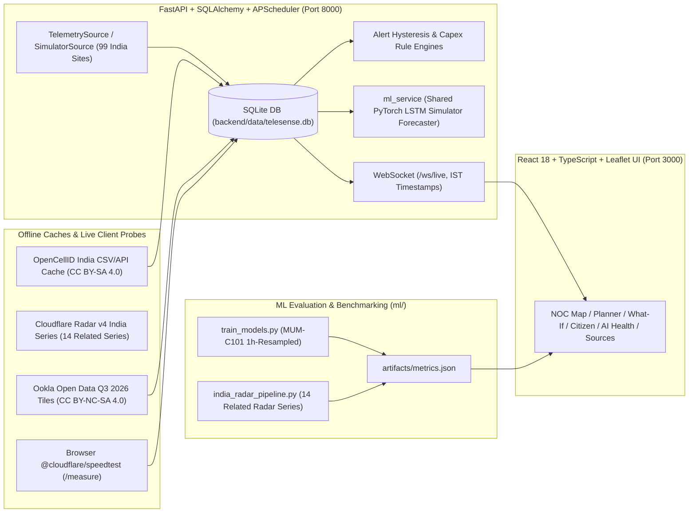

# TeleSense: India Cellular Capacity Forecasting & Network Planning Platform

TeleSense is a full-stack India-focused cellular capacity monitoring, short-horizon forecasting, and Capex planning web application. It separates **real public telemetry datasets** (OpenCellID cell records, Cloudflare Radar web-traffic series, Ookla mobile speed tiles, live browser speed tests) from **modelled forecasts** and **simulated RAN tower load** so operators and evaluators always know the provenance of every metric.

---

## 1. Architecture



Key directories:
- `backend/app/`: FastAPI API routers (`towers.py`, `alerts.py`, `recommendations.py`, `simulation.py`, `citizen.py`, `crowdsource.py`, `incidents.py`, `model_health.py`, `websocket.py`), data models, GeoJSON India/state polygon validation (`geo_validator.py`), ITU MCC/MNC lookup (`mcc_mnc_india.py`), Presenter Mode demo engine (`presenter_mode.py`), and offline CLI importers (`app/scripts/import_cloudflare_radar.py`).
- `ml/`: PyTorch LSTM/GRU sequence predictors (`models/neural_sequence.py`), Seasonal SARIMA baseline (`models/sarima_baseline.py`), chronological 1h-resampled dataset pipeline (`training/dataset.py`), simulator evaluation (`training/train_models.py`), Cloudflare Radar India evaluation (`training/india_radar_pipeline.py`), shared inference service (`training/ml_service.py`), and residual drift proxy monitor (`training/drift_monitor.py`).
- `frontend/`: React + TypeScript + Vite dashboard bounded to India on Leaflet with IST timestamps, ₹ Lakh/Crore Capex budgets, `>= 5` sample hex privacy aggregation on mobile speed tests, and EN / HI / TE / KN localization.
- `tests/`: Pytest backend, provenance, coordinate validation, split/selection integrity, and Playwright Chromium E2E tests plus frontend Vitest unit tests.

---

## 2. Provenance Breakdown: REAL vs MODELLED vs SIMULATED

| Layer / Feature | Classification | What It Actually Uses |
| :--- | :--- | :--- |
| **OpenCellID Radio Cells** | **REAL (Offline Cache)** | `7,542` in-India OpenCellID records grouped into `64` area clusters; coordinates checked against geoBoundaries India polygons, labelled `approximate position (about 1 km)`, displaying only real fields (`radio`, `MCC/MNC`, `LAC`, `cellid`, `samples`, `fetched_at`). No synthetic load is shown on raw cell records. |
| **Cloudflare Radar India Series** | **REAL (Offline Cache)** | Hourly web-traffic indices (`[0, 100]` normalised scale per series) across `14` related series trimmed to the identical `2,543`-hour common window (`2026-07-29T10:00` to `2026-11-12T08:00` UTC): `IN`, 7 state subsets, and top 6 India-registered ASNs ranked by `/radar/http/top/ases` (`AS55836` Reliance Jio, `AS45609` Bharti Airtel GPRS, `AS24560` Bharti Airtel Telemedia, `AS38266` & `AS45271` Vodafone Idea, `AS9829` BSNL NIB; type inferred from AS name because Radar API omits ASN type; Rank #5 `AS8075` Microsoft Corporation was skipped because it is US-registered `country=US`). Marked `Relative web traffic (Cloudflare Radar), not tower load` and `network-level web traffic, may include fixed broadband`. Across the `2,543`h common window: **Seasonal-Naive `4.21` MAE**, **SARIMA `3.56` MAE (`+15.4%`)**, **LSTM `3.35` MAE (`+20.4%`)**, **GRU `3.37` MAE (`+20.0%`)**. |
| **Ookla Speed Tiles** | **REAL (Offline Cache)** | Q3 2026 `s3://ookla-open-data` India mobile performance quadkey tiles clipped strictly to India polygons. |
| **Phone Speed Test (`/measure`)** | **REAL (Live Probe)** | Browser measurements via `@cloudflare/speedtest`; automated/localhost runs are flagged (`is_test`) and excluded from real mobile counters. |
| **Published Event Studies** | **REAL CITATIONS** | Incident modal summaries strictly quoting Ookla (Maha Kumbh 2025 speeds/availability), Reliance Jio & Ericsson (20M voice / 400M data requests), and Opensignal (IPL 2023 stadium speeds via ET Telecom). |
| **24h Forecasts & Capex ROI** | **MODELLED** | Shared simulator PyTorch LSTM checkpoint trained on 1h-resampled `MUM-C101` (`Val MAE 1.85`, `Test MAE 2.10` vs Seasonal-Naive `2.36`), active-user catchment estimates, citizen area quality estimates, and planning rules (`85%` capacity warning is an engineering planning threshold, not a statutory rule). |
| **99 NOC Towers, Alerts & Demo Scenarios** | **SIMULATED** | India-calibrated synthetic telemetry streams (`load_pct`, `active_users`, `throughput`, `rsrp_dbm`, `sinr_db`), Presenter Mode scenario overrides, Demo alerts, and What-If stress sliders. |

---

## 3. Data Sources, Links & Licences

| Source | Category | URL | Licence / Terms |
| :--- | :--- | :--- | :--- |
| **OpenCellID** | Crowdsourced Cell IDs | https://opencellid.org/ | CC BY-SA 4.0 |
| **Cloudflare Radar** | India / State / ASN Web Traffic | https://developers.cloudflare.com/radar/ | Cloudflare Radar Open Telemetry (API v4) |
| **Ookla Open Data** | Mobile Performance Tiles (Q3 2026) | https://github.com/teamookla/ookla-open-data | CC BY-NC-SA 4.0 |
| **Cloudflare Speed Test** | Client Edge Throughput & Latency | https://speed.cloudflare.com/ | Apache 2.0 (`@cloudflare/speedtest`) |
| **TRAI Press Release 104/2026** | Telecom Subscriber Statistics | https://www.trai.gov.in/sites/default/files/2026-07/PR_No104of2026_0.pdf | Government of India Open Data (GODL) |
| **TRAI Performance Indicators** | Average Monthly Data Usage | https://www.trai.gov.in/release-publication/reports/performance-indicators-reports | Government of India Open Data (GODL) |
| **TRAI QoS Regulations 2024 (PR 47/2024)** | Statutory QoS Benchmarks (DCR <= 2%) | https://www.trai.gov.in/sites/default/files/2024-08/PR_No.47of2024.pdf | Statutory Regulatory Publication |
| **Ookla Maha Kumbh 2025 Report** | High-Density 5G Benchmarks | https://www.ookla.com/articles/5g-maha-kumbh-feb25 | Editorial / Attribution |
| **Jio & Ericsson Maha Kumbh Statement** | Peak-Day Voice & Data Volume | https://telecom.economictimes.indiatimes.com/news/industry/maha-kumbh-2025-ericsson-says-enabled-jio-5g-network-to-handle-400-mn-data-service-requests-at-peak/118603781 | ET Telecom News Citation |
| **Opensignal IPL 2023 Study** | Stadium 5G vs 4G Speeds | https://economictimes.indiatimes.com/industry/telecom/telecom-news/eden-gardens-tops-in-5g-download-speeds-this-ipl-open-signal/articleshow/100425243.cms | ET Telecom News Citation |
| **Drik Panchang 2026 Calendar** | Festival Date Reference (regional +/- 1 day) | https://www.drikpanchang.com/calendars/indian/indiancalendar.html?year=2026 | Public Reference Calendar |
| **ITU-T E.212 MCC/MNC India List** | Operator Lookup Table | https://en.wikipedia.org/wiki/Mobile_network_codes_in_ITU_region_4xx_(Asia) | CC BY-SA 4.0 |

---

## 4. Limitations

1. **No Private Carrier RAN Counters:** Telecom operators do not publish per-cell live PRB utilization, RSRP, or active UE counts; NOC map tower loads are India-calibrated simulations rather than live operator OSS feeds.
2. **Radar vs Cellular Load Scope:** Cloudflare Radar models validate the forecasting method on real web traffic (`IN`, 7 state subsets, and top 6 India-registered ASNs selected by Radar traffic); operator ASN traffic includes network-level HTTP traffic that may include fixed broadband/enterprise fiber.
3. **Shared Simulator Checkpoint:** The live 24h NOC forecast uses a single shared simulator LSTM checkpoint trained on 1h-resampled `MUM-C101` telemetry rather than 99 separately trained per-site models.
4. **Festival Features Result:** Adding 2026 Indian festival and Diwali-week flags did not improve held-out Radar test MAE (`3.37` base GRU vs `3.86` with festival flags, `+14.5%`; `3.02 -> 3.02` val MAE), so festival flags are excluded from serving.
5. **OpenCellID Spatial Precision:** Indian OpenCellID coordinates are quantized (~1 km accuracy) cell records, not physical tower coordinates.

---

## 5. Plugging In a Real Operator Feed

1. Subclass [`TelemetrySource`](backend/app/services/telemetry_source.py) and implement `get_latest_readings(db: Session, simulated_time: datetime) -> List[Reading]` pulling live PM/OSS KPIs (Kafka, NetAct/ENM export, or operator REST stream) mapped to `tower_id`, `load_pct`, `active_users`, `avg_throughput_mbps`, `rsrp_dbm`, and `sinr_db`.
2. Wire the new source class in `backend/app/services/telemetry_source.py` and select it via `DATA_SOURCE` in `backend/app/config.py` (never modifying OpenCellID/Radar caches at request time).
3. Backfill real per-site hourly history into `Reading`, run `python ml/training/train_models.py` (using strict chronological splits and validation-MAE model selection), and switch telemetry provenance labels from `SIMULATED` to the connected operator feed identifier.

---

## 6. Running Locally & Testing

```bash
# 1. Environment keys (optional, offline-only; never committed)
# backend/.env -> OPENCELLID_API_KEY=... , CLOUDFLARE_API_TOKEN=...

# 2. Backend & ML pipelines (offline import + chronological evaluation)
cd backend && PYTHONPATH=.:.. uvicorn app.main:app --host 0.0.0.0 --port 8000
PYTHONPATH=backend:. python3 -m backend.app.scripts.import_cloudflare_radar
PYTHONPATH=backend:. python3 ml/training/train_models.py
PYTHONPATH=backend:. python3 ml/training/india_radar_pipeline.py

# 3. Frontend build & unit tests
cd frontend && npm install && npm test && npm run build
npm run preview -- --port 3000 --host 0.0.0.0

# 4. Full Pytest + Chromium Playwright suite (30 tests)
PYTHONPATH=backend:. pytest tests/ -v
```
