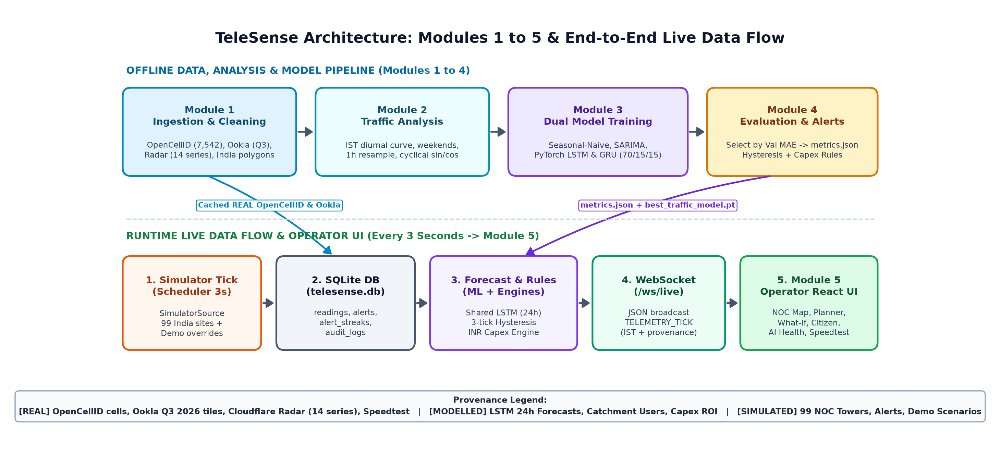
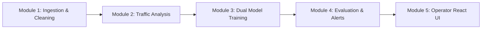

# TeleSense — Complete B.Tech Project Guide

> **Audience:** B.Tech student preparing for project viva and technical walkthroughs.
> **Provenance Promise:** Every dataset, number, model score, and UI badge below comes directly from the actual repository code, `backend/data/telesense.db`, `backend/data/cloudflare_radar_india.json`, `backend/data/ookla_india_tiles.json`, and `artifacts/metrics.json`. Nothing is invented, and no API keys or secrets appear in this guide.

## Table of Contents

- [0. Project Overview](#0-project-overview)
- [1. Data](#1-data)
- [2. Models](#2-models)
- [3. APIs and External Services](#3-apis-and-external-services)
- [4. Features](#4-features)
- [5. Modules (Module 1 to Module 5)](#5-modules-module-1-to-module-5)
- [6. Technology Stack and Languages](#6-technology-stack-and-languages)
- [7. Real vs Modelled vs Simulated](#7-real-vs-modelled-vs-simulated)
- [8. Limitations and Future Work](#8-limitations-and-future-work)
- [9. How to Run](#9-how-to-run)
- [10. Glossary](#10-glossary)
- [11. Viva Questions and Answers](#11-viva-questions-and-answers)
- [12. Sources](#12-sources)

---

## 0. Project Overview

In one line: TeleSense helps telecom engineers spot busy mobile towers early, plan rupee-budget upgrades, and separate real public measurements from simulated tower loads.

**The Problem:** Mobile users experience buffering and call drops when a cellular tower becomes overloaded in the evening or during a crowded event like an IPL cricket match or a festival. Normally, engineers only find out after users complain.

**What TeleSense Does:**

1. Displays an interactive map of India showing telecom cell sites, speed layers, and network health.
2. Uses time-series machine learning models to forecast traffic load up to 24 hours ahead.
3. Fires alerts before a crisis (at 85% planning warning load, 95% critical load, or weak signal), and recommends exact rupee fixes such as adding spectrum bandwidth or building a new tower.
4. Lets citizens check estimated area quality and run a live browser speed test against Cloudflare edge servers.

**Who Uses It:**

- **NOC (Network Operations Center) Engineers:** Monitor live tower health, inspect alerts, and approve fixes.
- **Network Capex Planners:** Rank sites by urgency and budget upgrades in Indian Rupees (Lakhs and Crores).
- **Students & Evaluators / Citizens:** Test area coverage, run live speed tests, and trigger realistic stress demos safely.

**What Is Real vs Simulated Summary:**
TeleSense uses **REAL** offline datasets for cell tower radio records (`7,542` OpenCellID records), quarterly mobile speed tiles (`442,875` Ookla India tiles summarised, `2,445` cached for display), national/state/operator web-traffic curves (`14` Cloudflare Radar India series), regulatory stats (TRAI), and live browser speed tests (`/measure`). Because Indian telecom operators do not publish private per-tower CPU/PRB utilization or active user counts, the `99` interactive NOC towers (`3,366,989` telemetry rows in SQLite) are **SIMULATED** on a curve calibrated to Indian IST peaks, while 24-hour forecasts, catchment active-user estimates, and Capex payback periods are **MODELLED**.

---

## 1. Data

In one line: TeleSense combines five offline REAL public datasets, one calibrated SIMULATED tower stream, and live REAL browser speed tests, while separating every item cleanly.

### 1.1 OpenCellID Radio Cell Records (`REAL`)
- **Where it came from:** OpenCellID API (`https://opencellid.org/`, CC BY-SA 4.0) via offline importer [backend/app/scripts/import_opencellid.py](backend/app/scripts/import_opencellid.py). Fetched on `2026-11-11` to `2026-11-12`.
- **What it contains:** `7,542` individual radio cell records (`radio`, `mcc`, `mnc`, `lac`, `cellid`, `lat`, `lon`, `range`, `samples`, `fetched_at`, `city`, `state`, `in_india_polygon`). Zero records fell outside India boundaries (`0` polygon failures against `backend/data/india_states.geojson`).
- **Breakdown in database (`opencellid_cells`):**
  - **By city (7 cities):** Bengaluru (`1,463`), Hyderabad (`1,318`), Mumbai (`1,208`), Chennai (`1,151`), Kolkata (`1,000`), Delhi (`920`), Tirupati (`482`).
  - **By radio technology:** GSM (`3,396`), UMTS (`2,160`), LTE (`1,948`), NR 5G (`38`).
  - **By MCC (India mobile country codes):** MCC `404` (`5,082`), MCC `405` (`2,460`), MCC `406` (`0` records returned).
- **Why collected & used:** Proves real multi-operator cellular presence across Indian cities. On the map, records are binned on a `0.01°` latitude/longitude grid into `64` area clusters (radius `> 2 km`, labelled `area cluster (N cell records)`). Zooming to level `13+` shows individual cell records. Operator names come only from a cited public ITU E.212 / Wikipedia MCC/MNC table in [backend/app/services/mcc_mnc_india.py](backend/app/services/mcc_mnc_india.py), with fallback `MCC xxx / MNC yy`.
- **Limitation:** Indian OpenCellID coordinates are rounded to ~1 km (`approximate position (about 1 km)`). They represent radio cell observations, not physical street-level mast pins, and contain no live traffic load.

### 1.2 Cloudflare Radar India Hourly Series (`REAL`)
- **Where it came from:** Cloudflare Radar API v4 (`https://developers.cloudflare.com/radar/`) via offline script [backend/app/scripts/import_cloudflare_radar.py](backend/app/scripts/import_cloudflare_radar.py). Fetched on `2026-11-12T10:43:02Z`.
- **What it contains:** `14` related hourly web-traffic series (`35,602` total hourly points), trimmed to an identical `2,543`-hour common window (`2026-07-29T10:00:00Z` to `2026-11-12T08:00:00Z`). Each series is normalised to a `[0, 100]` index where `100` is the peak hour in that window (`unit: Relative web traffic (Cloudflare Radar), not tower load`).
- **All 14 Series in `cloudflare_radar_india.json`:**

| # | Series ID | Type | AS Name / Region Name | Radar IN Share & Note |
| :---: | :--- | :--- | :--- | :--- |
| 1 | `IN` | Country | India (All Traffic) | National baseline index |
| 2 | `IN-MH` | State (subset) | Maharashtra | State subset of India |
| 3 | `IN-DL` | State (subset) | Delhi NCT | State subset of India |
| 4 | `IN-KA` | State (subset) | Karnataka | State subset of India |
| 5 | `IN-TN` | State (subset) | Tamil Nadu | State subset of India |
| 6 | `IN-TG` | State (subset) | Telangana | State subset of India |
| 7 | `IN-UP` | State (subset) | Uttar Pradesh | State subset of India |
| 8 | `IN-WB` | State (subset) | West Bengal | State subset of India |
| 9 | `ASN-55836` | Operator ASN | Reliance Jio Infocomm Limited (`RELIANCEJIO-IN`) | Rank #1 (`36.44%`); Mobile & Fixed Telecom ISP (inferred from AS name) |
| 10 | `ASN-45609` | Operator ASN | Bharti Airtel Ltd. AS for GPRS Service (`BHARTI-MOBILITY-AS-AP`) | Rank #2 (`22.51%`); Mobile / GPRS & Operator Network — may include fixed (inferred from AS name) |
| 11 | `ASN-24560` | Operator ASN | Bharti Airtel Ltd., Telemedia Services (`AIRTELBROADBAND-AS-AP`) | Rank #3 (`8.82%`); Fixed Broadband & Access ISP (inferred from AS name) |
| 12 | `ASN-38266` | Operator ASN | Vodafone Idea Ltd (`VIL-AS-AP`) | Rank #4 (`3.70%`); Mobile & Fixed Telecom ISP (inferred from AS name) |
| 13 | `ASN-45271` | Operator ASN | Vodafone Idea Ltd (`ICLNET-AS-AP`) | Rank #6 (`2.20%`); Mobile & Fixed Telecom ISP (inferred from AS name) |
| 14 | `ASN-9829` | Operator ASN | National Internet Backbone (`BSNL-NIB`) | Rank #7 (`1.82%`); National Backbone & Multi-Access ISP (inferred from AS name) |

- **Why Rank #5 was skipped:** Cloudflare Radar Rank #5 in India HTTP traffic was `AS8075` (**Microsoft Corporation**, `2.27%`, `country = US`, cloud/content provider). It was automatically skipped because the selector keeps only India-registered (`country == 'IN'`) telecom networks. Old low-rank `AS45117` was also dropped.
- **Why collected & used:** Validates our chronological ML forecasting pipeline (Seasonal-Naive, SARIMA, LSTM, GRU) on real public Indian hourly traffic patterns.
- **Limitation:** Measures HTTP web traffic, not cell-tower PRB load; operator ASNs represent network-level web traffic and may include fixed broadband or enterprise fiber; Cloudflare Radar's Entity API does not return an ASN type field, so network types on AI Health are explicitly labelled `inferred from AS name`.

### 1.3 Ookla Open Data Mobile Performance Tiles (`REAL`)
- **Where it came from:** Ookla Open Data public AWS S3 bucket (`s3://ookla-open-data`, `CC BY-NC-SA 4.0`) via offline script [backend/app/scripts/import_ookla.py](backend/app/scripts/import_ookla.py). Fetched on `2026-11-12T07:35:49Z` (`Q3 2026` mobile parquet).
- **What it contains:** Filtered strictly inside India boundary polygons: `442,875` India tiles across all `36` states/UTs (`3,085,600` total speed tests; weighted India average download `145.16 Mbps`, upload `16.0 Mbps`, latency `35.5 ms`). Top `2,445` representative tiles are cached in `backend/data/ookla_india_tiles.json`.
- **Why collected & used:** Powers the toggleable real mobile speed overlay layer on the NOC Map and provides regional speed benchmarks without calling AWS S3 at runtime.
- **Limitation:** Quarterly historical aggregate (Q3 2026), not live minute-by-minute telemetry; displays top `2,445` tiles for browser map speed.

### 1.4 TRAI Regulatory Statistics & Event Studies (`REAL`)
- **Where it came from:** Telecom Regulatory Authority of India (TRAI) Press Release `104/2026` (`1,300.25 M` total wireless subscribers, `1,282.38 M` mobile), Performance Indicators (`28.39 GB/month` avg subscriber usage), QoS Regulations `2024` (`PR 47/2024`, Drop Call Rate `<= 2.0%`), plus primary event reports from Ookla/Jio/Ericsson (Maha Kumbh 2025: `20M` voice / `400M` data requests) and Opensignal (IPL 2023 stadium 5G vs 4G study via ET Telecom).
- **Why collected & used:** Sets realistic regulatory thresholds (`<= 2.0%` DCR), active-user capacity assumptions (`38%` market share default), and primary-source context in the Data & Sources and Documented Event Studies views.
- **Limitation:** Macro circle-level figures, not individual tower logs.

### 1.5 Indian Festival Calendar & Simulator Multipliers (`REAL` dates / `SIMULATED` tower effect)
- **Where it came from:** 2026 Indian festival dates in IST referenced from Drik Panchang (`https://www.drikpanchang.com/calendars/indian/indiancalendar.html?year=2026`): `11` dates between Aug–Nov 2026 (`2026-08-15` Independence Day, `2026-08-28` Raksha Bandhan, `2026-09-04` Janmashtami, `2026-09-14` Ganesh Chaturthi, `2026-10-02` Gandhi Jayanti, `2026-10-21` Dussehra, `2026-11-06` Dhanteras, `2026-11-07` Naraka Chaturdashi, `2026-11-08` Diwali, `2026-11-09` Govardhan Puja, `2026-11-11` Bhai Dooj).
- **Used for:** Tested as ML features in `india_radar_pipeline.py` (ablation study), and used in [backend/app/services/telemetry_source.py](backend/app/services/telemetry_source.py) (`1.18x` festive evening multiplier; `1.16x` IPL Mar–May evening multiplier).
- **Limitation:** Regional Indian calendars can differ by one day around festivals.

### 1.6 Simulated NOC Tower Telemetry (`SIMULATED`)
- **Where it came from:** Generated locally by `SimulatorSource` in [backend/app/services/telemetry_source.py](backend/app/services/telemetry_source.py) across `99` seeded Indian towers (`seed_towers_data.py` spanning `74` cities across Indian states/UTs).
- **How it is made & calibrated:** Combines an IST diurnal cosine curve (night trough `01:00–05:00 IST`, prime evening surge `19:00–22:30 IST`), weekend boost, calendar multipliers, chronic-overloader offsets, and Gaussian noise, then calculates throughput and RSRP/SINR radio metrics.
- **What is in `telesense.db`:** `3,366,989` rows in `readings` (`2026-05-11 10:00:00` to `2026-11-12 11:39:09` UTC).
- **Limitation:** Synthetic cellular KPIs calibrated to Indian diurnal patterns, not live telecom operator OSS feeds.

### 1.7 Own Crowdsourced Speed Tests (`REAL` probe / `MODELLED` hex display)
- **Where it came from:** Browser tests run on `/measure` via `@cloudflare/speedtest`, saved into `crowdsource_measurements` via `POST /api/crowdsource`.
- **Database count:** `16` rows currently in DB: `0` real mobile-data phone runs (`is_test = 0`) and `16` automated/localhost test runs (`is_test = 1`, excluded from the header `REAL MOBILE TESTS` counter).
- **Limitation:** Public `0.02°` (~2.2 km) hex summaries require at least `5` distinct samples to protect privacy and reduce bias.

### Summary Table: All Datasets

| Data | Source | Why Used | Label |
| :--- | :--- | :--- | :--- |
| **OpenCellID Cells (`7,542`)** | OpenCellID API (`backend/.env` offline script) | Real cell locations (~1 km) & radio types | `REAL` |
| **Cloudflare Radar (`14` series)** | Cloudflare Radar v4 (`2,543`h common window) | Real India traffic curves & ML method check | `REAL` |
| **Ookla Tiles (`Q3 2026`)** | `s3://ookla-open-data` (anonymous parquet) | Quarterly real India mobile speed overlay | `REAL` |
| **TRAI & Event Studies** | TRAI PR 104/2026, PR 47/2024, Ookla, Opensignal | Subscriber ceiling, 2% DCR & event context | `REAL` |
| **Festival Calendar (`11` dates)** | Drik Panchang 2026 | Diwali/festival ablation & evening multipliers | `REAL` (dates) / `SIMULATED` (load effect) |
| **99 NOC Towers (`3,366,989` rows)** | `SimulatorSource` (Python) | Live NOC map, alerts, forecasts & demos | `SIMULATED` |
| **Citizen Speed Tests (`/measure`)** | `@cloudflare/speedtest` | Live edge download, upload, latency & jitter | `REAL` (`MODELLED` in aggregated views) |

---

## 2. Models

In one line: We test four time-series models strictly in time order, pick the serving winner using validation MAE only (never test MAE), and use a shared PyTorch LSTM checkpoint for live NOC forecasts.

### 2.1 Four Models Explained Simply

1. **Seasonal-Naive Baseline (Baseline Reference)**
   - **Plain-English Analogy:** *"Traffic at 8:00 PM today will be the same as traffic at 8:00 PM last week (`t - 168h`)."*
   - **Why used:** Sets the minimum honest bar. Any complex AI model only deserves credit if it beats this simple rule.
2. **SARIMA / Seasonal Decomposition Baseline**
   - **Plain-English Analogy:** *"Look at the repeated daily 24-hour wave, add recent trend adjustments, and project forward."* (`SeasonalBaselineModel`, period=24h).
   - **Why used:** Standard statistical benchmark from classical telecom forecasting.
3. **GRU (Gated Recurrent Unit, PyTorch)**
   - **Plain-English Analogy:** *"A smart notepad with two valves (update and reset) that keeps important daily habits and forgets old noise."* (`GRUTrafficPredictor`, `2` layers, hidden size `64`, dropout `0.2`, `HuberLoss`).
   - **Why used:** Lightweight deep-learning sequence network with fast training/inference.
4. **LSTM (Long Short-Term Memory, PyTorch)**
   - **Plain-English Analogy:** *"A memory bank with separate short-term and long-term notebooks so morning/night patterns and week-long habits stay clean."* (`LSTMTrafficPredictor`, `2` layers, hidden size `64`, dropout `0.2`, `HuberLoss`).
   - **Why used:** Captures multi-day nonlinear peaks across 48–72 hour windows better than simple heuristics.

### 2.2 Features and Strict Time-Ordered Training

- **Simulator input features (`7` features, `72h -> 24h` windows on `MUM-C101`):** `load_pct`, `hour_sin`, `hour_cos`, `dow_sin`, `dow_cos`, `is_weekend`, `active_users` (rescaled using train-only min/max).
- **Cloudflare Radar input features (`7` features, `48h -> 24h` windows across `14` series):** `load_pct` (0–100 index), `hour_sin`, `hour_cos`, `dow_sin`, `dow_cos`, `is_weekend`, `roll24` (24-hour rolling average).
- **Zero Data Leakage Split (`70% Train / 15% Validation / 15% Test`, chronological — never random k-fold):**

| Benchmark Dataset | Train Window | Validation Window | Test Window |
| :--- | :--- | :--- | :--- |
| **Cloudflare Radar (`14` series, `2,543`h)** | `2026-07-29T10:00` → `2026-10-11T13:00` | `2026-10-11T14:00` → `2026-10-27T10:00` | `2026-10-27T11:00` → `2026-11-12T08:00` |
| **India Simulator (`MUM-C101`, `4,440`h)** | `2026-05-11T10:00` → `2026-09-17T21:00` | `2026-09-17T22:00` → `2026-10-15T15:00` | `2026-10-15T16:00` → `2026-11-12T10:00` |

### 2.3 Exact Results from `artifacts/metrics.json`

**A) Cloudflare Radar India Series (`REAL` traffic, `[0, 100]` index, `5,026` test windows, series mean `64.67`):**

| Model | Val MAE | Test MAE | Test RMSE | Rel. Error (% mean) | 1h / 6h / 24h MAE | vs Seasonal-Naive |
| :--- | :---: | :---: | :---: | :---: | :---: | :--- |
| **Seasonal_Naive_Baseline** | `3.24` | `4.21` | `5.62` | `6.51%` | `4.33 / 4.23 / 4.15` | Reference baseline |
| **SARIMA** | `3.31` | `3.56` | `5.35` | `5.50%` | `3.50 / 3.53 / 3.62` | **Better (+15.44%)** |
| **LSTM (Val Winner)** | **`3.02`** | **`3.35`** | `4.47` | `5.18%` | `2.67 / 3.38 / 3.38` | **Better (+20.43%)** |
| **GRU** | `3.02` | `3.37` | `4.48` | `5.21%` | `2.81 / 3.52 / 3.47` | **Better (+19.95%)** |

**B) India-Calibrated Simulator Benchmark (`SIMULATED` `% load` on `MUM-C101`):**

| Model | Val MAE | Test MAE | Test RMSE | MAPE | 1h / 6h / 24h MAE | vs Seasonal-Naive |
| :--- | :---: | :---: | :---: | :---: | :---: | :--- |
| **Seasonal_Naive_Baseline** | `2.12` | `2.36` | `4.31` | `11.74%` | `2.36 / 2.35 / 2.46` | Reference baseline |
| **SARIMA_Baseline** | `3.96` | `4.56` | `6.24` | `21.62%` | `4.57 / 4.59 / 4.57` | Does **not** beat |
| **GRU** | `1.99` | `2.23` | `4.25` | `15.52%` | `2.38 / 2.40 / 2.45` | **Better** |
| **LSTM (Serving Model)** | **`1.85`** | **`2.10`** | `4.22` | `15.46%` | `2.15 / 1.97 / 2.51` | **Better (Serves NOC)** |

### 2.4 Worked Example of MAE (Mean Absolute Error)

MAE tells us, on average, how many percentage points (or index points) off a forecast is. Suppose actual traffic over 3 hours is `[60, 70, 80]` and our model predicts `[63, 68, 76]`. Errors are `|60-63| = 3`, `|70-68| = 2`, `|80-76| = 4`. Average = `(3 + 2 + 4) / 3 = 3.0 MAE`. Smaller MAE means closer forecasts.

### 2.5 Model Selection, Serving, Festival Experiment & Bug Fix

- **Serving Selection Rule:** `select_best_model_by_validation()` chooses strictly by lowest `val_mae_overall` (never test MAE, to avoid cheating on the test window). On the simulator, `LSTM` won (`Val MAE 1.85 < GRU 1.99 < Naive 2.12 < SARIMA 3.96`), so `/api/towers/{id}/forecast` serves **`PyTorch LSTM (Shared Simulator Model)`** from `ml/saved_models/best_traffic_model.pt` across all `99` simulated NOC towers (never on OpenCellID cells).
- **Festival Features Experiment (Honest Result):** Adding `2026` Indian festival & Diwali-week flags to GRU made validation unchanged (`3.02 -> 3.02`) and made held-out test error **worse** (`3.37 -> 3.86 MAE`, `+14.54%` worse error), mainly because Diwali traffic patterns differ across cities/days and a small 1-year window overfits. Therefore, festival flags were **excluded** from serving.
- **Simulator Bug Found & Fixed:** Earlier runs scored `11–12 MAE` because the database `readings` table stored both `1h` historical seeded points AND `3-second` live scheduler ticks. A `72`-row window was mistakenly mixing 3-second steps with 1-hour steps! Adding `.resample("1h").mean().interpolate().dropna()` in `ml/training/dataset.py` and `ml/training/ml_service.py` fixed alignment and reduced LSTM Test MAE to `2.10`.

---

## 3. APIs and External Services

In one line: Offline scripts fetch OpenCellID, Cloudflare Radar, and Ookla S3 data once into local caches, while the live running app only makes optional browser map-tile, geocoding, and user-initiated speed-test requests.

| External Service | What It Gives | Why Used | Free / Rate Limits | Where Key Lives | Calling Files | Live at Runtime? |
| :--- | :--- | :--- | :--- | :--- | :--- | :--- |
| **OpenCellID API** (`/cell/getInArea`, `getInAreaSize`) | Real Indian cell coordinates (~1 km), radio, MCC/MNC, LAC, cellid, samples | Real multi-city cellular records | `< 800 req/day` (script caps at `750/day`, `0.35s` sleep) | `OPENCELLID_API_KEY` in `backend/.env` | `backend/app/scripts/import_opencellid.py`, `backend/app/services/opencellid_client.py` | **No** (never called live from app) |
| **Cloudflare Radar v4** (`/radar/http/timeseries`, `/top/ases`, `/entities/asns`) | Hourly `[0, 100]` India, state & top ASN traffic curves + AS metadata | Real Indian hourly web traffic benchmark | API token rate limit (`0.35s` sleep, 28d stitched chunks) | `CLOUDFLARE_API_TOKEN` in `backend/.env` | `backend/app/scripts/import_cloudflare_radar.py` | **No** (unless user clicks manual offline pipeline button on AI Health) |
| **Ookla Open Data S3** (`s3://ookla-open-data`) | Quarterly mobile speed parquet tiles (Q3 2026) | Real India speed map layer | Public anonymous S3 access | None required | `backend/app/scripts/import_ookla.py` | **No** (cached in `ookla_india_tiles.json`) |
| **Cloudflare Speed Test** (`@cloudflare/speedtest`, `/cdn-cgi/trace`) | Client download, upload, RTT latency, jitter & edge city | Live browser crowdsource measurements | Public client SDK | None required | `frontend/src/views/CrowdsourceMeasureView.tsx` | **Only** when user clicks Start Speed Test |
| **Photon Geocoder** (`photon.komoot.io/api/`) | Indian place & locality lat/lon search (bbox India) | Map place search bar | Public OSM-based API | None required | `frontend/src/views/NocMapView.tsx` | **Only** when user searches a non-tower place name |
| **Esri Dark Gray & OSM Attribution** (`server.arcgisonline.com`) | Dark vector/raster basemap tiles | High-contrast India NOC map canvas | Public attribution terms | None required | `frontend/src/views/NocMapView.tsx` | **Only** browser Leaflet map pan/zoom |

*(Note: `.env.example` lists the blank variable template `OPENCELLID_API_KEY=` and `CLOUDFLARE_API_TOKEN=`; real secrets are stored only in `backend/.env` and excluded via `.gitignore`.)*

---

## 4. Features

In one line: TeleSense exposes 16 user-facing capabilities spanning live NOC map monitoring, alert hysteresis, rupee Capex recommendations, what-if stress testing, citizen checks, speed testing, and multi-language clarity.

| Feature | What It Does & Why It Exists | How to See It in App | Implementing Files |
| :--- | :--- | :--- | :--- |
| **Live WebSocket Updates** | Streams simulated telemetry, alerts, and summary counts every 3s without page refresh | Green `LIVE` badge + `"Updated Xs ago"` in top bar | `backend/app/services/scheduler.py`, `backend/app/api/websocket.py`, `frontend/src/services/websocket.ts` |
| **NOC Map & India Bounds** | Shows 99 simulated sites, 64 OpenCellID clusters (`zoom >= 13` reveals cells), and Ookla speed layer; locks view to India & dims abroad | Default landing tab `NOC Map` | `frontend/src/views/NocMapView.tsx`, `backend/app/api/towers.py`, `backend/data/india_states.geojson` |
| **Fuzzy & Place Search** | Finds towers by ID/city/state/operator (`Fuse.js`) or flies to any Indian locality via Photon geocoder | Search box at top-left of `NOC Map` | `frontend/src/views/NocMapView.tsx` |
| **Alerts & Hysteresis** | Fires `PREDICTED_OVERLOAD`, `WEAK_COVERAGE`, `OUTAGE`, `DEGRADED_SPEED` after 3 consecutive ticks (`COOLDOWN 15m`) + audit log | Bell icon in top bar (`AlertsDrawer`) | `backend/app/services/alert_engine.py`, `backend/app/api/alerts.py`, `frontend/src/components/AlertsDrawer.tsx` |
| **Recommendation Engine** | Classifies bottleneck into New Macro Tower (`₹35L`), Small Cell (`₹7.5L`), Carrier Agg. Bandwidth (`₹3.5L`), CoW (`₹65k`), Backhaul Repair (`₹45k`), or Micro-Sleep (`₹0`) | Tower Drawer Level 3 & `Capex Planner` | `backend/app/services/recommendation_engine.py`, `backend/app/api/recommendations.py` |
| **What-If Lab** | Simulates adding users, +% traffic growth, or adding a spectrum carrier before congestion hits | Top tab `What-If Lab` | `frontend/src/views/WhatIfLabView.tsx`, `backend/app/api/simulation.py` |
| **Capex Planner** | Ranks all 99 towers by priority with ₹ Lakh/Crore budget totals + CSV export | Top tab `Capex Planner` | `frontend/src/views/PlannerView.tsx`, `frontend/src/utils/indiaFormat.ts` |
| **Citizen View** | Plain-language mobile quality estimate for Indian cities/states + crowdsource hex check (`>= 5` sample rule) | Top tab `Citizen View` | `frontend/src/views/CitizenPortalView.tsx`, `backend/app/api/citizen.py` |
| **Speed Test (`/measure`)** | Runs real `@cloudflare/speedtest`, logs IST time, flags automated/localhost runs (`is_test`), excludes non-mobile tests from real count | Top tab `Speedtest` | `frontend/src/views/CrowdsourceMeasureView.tsx`, `backend/app/api/crowdsource.py` |
| **Presenter / Demo Mode** | Launches 6 realistic simulated stress scenarios (IPL Surge, Diwali, Rural Hole, Fibre Cut, Cyclone, Mela) with `Apply Fix` & `Reset` | `Presenter mode` button (`Ctrl+Shift+D`) | `backend/app/services/presenter_mode.py`, `backend/app/api/simulation.py`, `frontend/src/components/PresenterModePanel.tsx` |
| **AI Health Page** | Displays Simulator leaderboard, 14-series Cloudflare Radar validation, Diwali last-7d error chart, festival ablation & drift | Top tab `AI Health` | `frontend/src/views/ModelHealthView.tsx`, `backend/app/api/model_health.py` |
| **Data & Sources Page** | Lists every dataset, licence, URL, OpenCellID polygon count, and 85% planning assumption | Top tab `Data & Sources` | `frontend/src/views/DataSourcesView.tsx` |
| **Offline Banner & PWA** | Warns when browser loses internet (`navigator.onLine`) and caches shell assets via Service Worker (`sw.js`) | Amber top banner on network disconnect | `frontend/src/App.tsx`, `frontend/public/manifest.json`, `frontend/public/sw.js` |
| **4 App Languages** | Switches UI instantaneously across English (`EN`), Hindi (`हिन्दी`), Telugu (`తెలుగు`), and Kannada (`ಕನ್ನಡ`) | Language dropdown in navbar | `frontend/src/i18n/translations.ts`, `frontend/src/components/Navbar.tsx` |
| **Simple vs Engineer View** | Switches Tower Drawer labels between plain English (`Current Load`, `Signal Quality`) and RF engineering terms (`Capacity Utilization`, `RSRP Power`) | `Simple / Engineer` pill inside Tower Drawer | `frontend/src/components/TowerDetailDrawer.tsx` |
| **REAL/MODELLED/SIMULATED Badges** | Marks every metric on headers, cards, clusters, and charts with explicit data provenance | Header banner, tower drawers & AI Health | `frontend/src/components/NetworkHealthBanner.tsx`, `frontend/src/views/*` |

**Worked Example — Recommendation Engine (`recommendation_engine.py`):**

- *Case A (Good Signal + High Load):* Tower has `RSRP = -82 dBm` (`> -90`, good signal) and `load = 91%` (`>= 85%`, overloaded). Users are close to the mast, only lanes are full. Action: **ADD BANDWIDTH (CARRIER AGGREGATION)** for **₹3,50,000** (`6 months` payback).
- *Case B (Poor Signal + High Load):* Tower has `RSRP = -117 dBm` (`<= -105`, poor signal) and `load = 89%` (`>= 85%`). Users are too far from the tower AND traffic is full. Action: **BUILD NEW TOWER (PRIORITY 1)** for **₹35,00,000** (`14 months` payback).
- *Case C (Healthy Headroom):* Tower has `RSRP = -80 dBm` and `load = 42%`. Action: **NO ACTION (RADIO MICRO-SLEEP)** saving 18.5% energy between `01:00–05:00 IST` at **₹0** cost.

---

## 5. Modules (Module 1 to Module 5)

In one line: TeleSense maps five clean offline-to-live software modules connecting data ingestion, analysis, dual ML training, evaluation/rules, and the live React operator UI.





### Module Mapping Table

| Module | Purpose | Input | Output | Exact Project Files | Connects Next To |
| :--- | :--- | :--- | :--- | :--- | :--- |
| **Module 1: Ingestion & Cleaning** | Fetch public India telemetry once offline, clip to India polygons, clean schema | OpenCellID API, Radar v4 API, Ookla S3, India GeoJSON | `opencellid_cells` (`7,542`), `cloudflare_radar_india.json` (`14` series), `ookla_india_tiles.json` (`2,445`) | `import_opencellid.py`, `import_cloudflare_radar.py`, `import_ookla.py`, `geo_validator.py`, `mcc_mnc_india.py` | **Module 2** |
| **Module 2: Traffic Analysis** | Align timestamps, resample 1h buckets, build IST diurnal/weekend curves & cyclical features | `readings` table, `cloudflare_radar_india.json`, 2026 festival dates | 7-feature tensors (`sin`/`cos` hour & day, rolling 24h), IST calibrated curves | `ml/training/dataset.py`, `telemetry_source.py`, `time_utils.py`, `seed_towers_data.py` | **Module 3** |
| **Module 3: Dual Model Training** | Train PyTorch LSTM/GRU + SARIMA & Seasonal-Naive on both Radar & Simulator windows | `70% / 15% / 15%` chronological sliding windows | `best_traffic_model.pt` (`LSTM`), `ml/models/*`, `india_radar_pipeline.py` outputs | `ml/models/neural_sequence.py`, `ml/models/sarima_baseline.py`, `ml/training/train_models.py`, `train_pipeline.py`, `india_radar_pipeline.py` | **Module 4** |
| **Module 4: Evaluation, Forecasts & Alerts** | Select winner strictly by Val MAE, check drift, evaluate 3-tick hysteresis alerts & ₹ Capex rules | Trained weights, latest DB readings, alert streaks | `artifacts/metrics.json`, 24h forecasts, deduplicated alerts, INR recommendations | `ml/training/ml_service.py`, `drift_monitor.py`, `alert_engine.py`, `recommendation_engine.py`, `presenter_mode.py` | **Module 5** |
| **Module 5: Operator & Citizen UI** | Visualize India map, AI Health, Planner, What-If, Citizen Portal, Speedtest & multi-language views | REST (`/api/*`) & WebSocket (`/ws/live`) JSON | Live interactive React dashboard (`EN`/`HI`/`TE`/`KN`) | `frontend/src/App.tsx`, `views/*`, `components/*`, `services/*`, `i18n/translations.ts` | End Users (NOC / Citizens) |

### End-to-End Live Data Flow (Every 3 Seconds)
1. **Simulator Tick (`scheduler.py`):** APScheduler runs `live_telemetry_tick_job()` every 3 seconds, asking `SimulatorSource` (with any active `PresenterMode` overrides) for a fresh telemetry reading for all `99` towers.
2. **Database (`telesense.db`):** FastAPI commits the new `Reading` rows and updates `alert_streaks`, `alerts`, and `alert_audit_logs`.
3. **Forecast & Alerts (`alert_engine.py` & `ml_service.py`):** `evaluate_reading_alerts()` enforces 3-interval hysteresis and 15-minute cooldowns; fleet counts (`healthy`, `at_risk`, `weak_coverage`, `critical`, `outage`) come strictly from open DB alerts; on-demand forecasts query the shared LSTM model (`best_traffic_model.pt`).
4. **WebSocket (`websocket.py`):** `ws_manager.broadcast()` pushes a `TELEMETRY_TICK` JSON packet (`IST` timestamp, summary counts, readings, new alerts, presenter status) to all connected browsers.
5. **Screen (`App.tsx` + `NocMapView.tsx`):** React merges updates smoothly (falling back to REST polling if WebSocket drops), updates marker colors, banners, and drawers cleanly.

### Added Beyond the Original Five Modules
- **GeoBoundaries India Polygon Validator** (`geo_validator.py`) & **ITU MCC/MNC Lookup** (`mcc_mnc_india.py`).
- **Ookla Q3 2026 Open Data Importer** & map speed overlay (`import_ookla.py`).
- **Presenter Mode Engine** (`presenter_mode.py`) with 6 India demo scenarios, ramp progression, and clean `source='demo'` reset.
- **Browser Crowdsource Speed Test (`@cloudflare/speedtest`)** with localhost/bot `is_test` filtering & `>= 5` sample hex privacy aggregation.
- **Pluggable `TelemetrySource` Adapter Interface** (`telemetry_source.py`), **4-language i18n (`EN`/`HI`/`TE`/`KN`)**, **Offline PWA Shell (`sw.js`)**, and **35 automated tests** (32 Pytest + 3 Vitest).

---

## 6. Technology Stack and Languages

In one line: TeleSense uses Python for backend APIs and PyTorch ML, TypeScript/React for the web UI, and SQLite/SQL for persistence.

| Category | Technology / Library | Why Chosen (In One Line) | Where Confirmed in Repo |
| :--- | :--- | :--- | :--- |
| **Languages** | **Python 3**, **TypeScript / JavaScript**, **SQL**, **HTML/CSS**, **Bash** | Python for ML/FastAPI, TypeScript for type-safe React UI, SQL for querying telemetry | `.py`, `.ts`, `.tsx`, `sqlite3`, `index.html`, `run.sh` |
| **Backend Framework** | **FastAPI + Uvicorn + Pydantic** | Fast async REST + WebSocket server with automatic JSON schema validation | `backend/requirements.txt`, `backend/app/main.py` |
| **Scheduling & DB** | **SQLAlchemy 2 + SQLite (`telesense.db`) + APScheduler** | Zero-setup relational file database plus reliable 3-second telemetry ticks | `backend/app/database.py`, `backend/app/services/scheduler.py` |
| **ML & Data** | **PyTorch, NumPy, Pandas, Statsmodels, Scikit-learn** | Builds LSTM/GRU neural networks, SARIMA decomposition, and chronological resampling | `backend/requirements.txt`, `ml/models/*`, `ml/training/*` |
| **Data Importers** | **Requests, PyArrow, python-dotenv** | Reads `.env` safely, calls offline APIs, and parses Ookla Parquet files | `backend/app/scripts/*` |
| **Frontend Stack** | **React 18, Vite 5, Tailwind CSS, TypeScript** | Fast component UI and crisp dark dashboard styling | `frontend/package.json` |
| **Map & Search UI** | **Leaflet (`1.9.4`), Fuse.js (`7.5`), Lucide Icons, `@cloudflare/speedtest`** | Lightweight India-bounded interactive maps, fuzzy search, crisp icons, real edge tests | `frontend/package.json`, `NocMapView.tsx`, `CrowdsourceMeasureView.tsx` |
| **Testing & Containers** | **Pytest, Playwright Chromium, Vitest, Docker Compose** | Verifies backend logic, metric honesty, UI rendering in Chromium, and container builds | `tests/*`, `docker-compose.yml`, `vitest.config.ts` |

**UI Languages & Translation Implementation:**
The app header language selector switches seamlessly among **English (`en`)**, **Hindi (`hi` — हिन्दी)**, **Telugu (`te` — తెలుగు)**, and **Kannada (`kn` — ಕನ್ನಡ)**. Translations live in a dictionary map `TRANSLATIONS` inside `frontend/src/i18n/translations.ts` and use `translate(language, key, vars)` with safe fallback to English if a key is missing.

---

## 7. Real vs Modelled vs Simulated

In one line: Every number on screen carries an honest label distinguishing real measurements (`REAL`), math/AI estimates (`MODELLED`), and synthetic tower telemetry (`SIMULATED`) — because telecom operators do not publish private per-tower feeds.

| Screen Number / Item | Category | Exact Explanation |
| :--- | :--- | :--- |
| **OpenCellID Cell Records (`7,542`), Radio, MCC/MNC, LAC, Cell ID, Samples** | `REAL` | Fetched from OpenCellID API into `opencellid_cells`; coordinates labelled ~1 km approximate |
| **Cloudflare Radar Indices & MAE Benchmarks (`14` series, `2,543`h)** | `REAL` | Fetched offline from Cloudflare Radar v4 API; normalised web traffic (`[0, 100]`) |
| **Ookla Q3 2026 Tile Speeds (`145.16 Mbps` India avg)** | `REAL` | Public quarterly Ookla mobile parquet clipped inside India polygons |
| **Browser Speed Test Results (`/measure`) & Real Test Counter** | `REAL` | Live measurements to Cloudflare edge; automated/localhost runs (`is_test=1`) excluded from counter |
| **TRAI Subscribers (`1,300.25 M`), Data Usage (`28.39 GB/mo`), QoS DCR (`<= 2.0%`)** | `REAL` | Quoted from TRAI PR 104/2026, Performance Indicators & PR 47/2024 |
| **Published Event Studies (`2` modal studies)** | `REAL` | Quoted from Ookla Maha Kumbh, Jio/Ericsson ET Telecom, and Opensignal IPL reports |
| **24-Hour Load Forecasts & Confidence Bands** | `MODELLED` | Predicted by shared PyTorch `LSTM` checkpoint trained on `MUM-C101` (`Val MAE 1.85`, `Test MAE 2.10`) |
| **Capex Priorities, ₹ Budgets, Payback Months & What-If Projections** | `MODELLED` | Computed by deterministic capacity engineering rules (`85%` planning threshold assumption) |
| **Citizen Area Quality Estimates & H3/Grid Aggregates** | `MODELLED` | Derived from regional tower state, TRAI defaults & `>= 5` sample crowdsource hex binning |
| **99 NOC Towers (`load_pct`, `active_users`, `throughput`, `rsrp_dbm`, `sinr_db`)** | `SIMULATED` | India-calibrated IST sinusoidal + festival curve from `SimulatorSource` |
| **Alerts, Demo Deltas, Presenter Mode Scenarios (6 scenarios)** | `SIMULATED` | Synthetic overload/outage ramps & hysteresis state machine for testing/viva |

**Honest Answer — Is This Real-Time Operator Data?**
**No.** Indian operators (Jio, Airtel, Vi, BSNL) do not expose live per-cell PRB utilization, user counts, or RSRP publicly for security and commercial reasons. TeleSense clearly labels the operator feed `Not connected` in the header. To make integration easy, `backend/app/services/telemetry_source.py` defines an abstract `TelemetrySource` class (`get_latest_readings()`): swapping in a real operator Kafka/OSS/REST stream requires subclassing `TelemetrySource` and changing `DATA_SOURCE` in `config.py`, with zero changes to map, alert, or UI code.

---

## 8. Limitations and Future Work

In one line: TeleSense is completely open about its current approximations—relative web units, ~1 km cell rounding, a shared single-site forecast model, no live carrier OSS link, a ~16-day Radar test window, and machine-translated Kannada strings.

1. **Relative Web Traffic vs RAN Tower Load (`Cloudflare Radar`):** Radar gives `[0, 100]` normalised HTTP web traffic, not cellular PRB utilization, and ASN series include network-level traffic that can include fixed broadband/enterprise fiber.
2. **OpenCellID ~1 km Spatial Rounding:** Indian coordinates in OpenCellID are rounded (`~1 km` accuracy), so `64` map clusters represent aggregate radio areas (`> 2 km` radius), not exact physical mast coordinates.
3. **One Shared Simulator Forecast Model:** Live NOC tower forecasts load one shared PyTorch LSTM checkpoint trained on `MUM-C101` rather than `99` separate site-specific models.
4. **No Live Telecom Operator Feed Connected:** Real tower PRB/RSRP/subscriber counters require enterprise 3GPP Northbound / OSS integration (`TelemetrySource` adapter is ready, but disconnected).
5. **Short Held-Out Radar Test Window (~16 Days):** Due to Cloudflare Radar's 28-day chunk window rules, stitching 4 chunks yields ~106 days (`2,543` hours), leaving `~16` days (`2026-10-27` to `2026-11-12`) for held-out testing—especially sensitive around irregular Diwali dates.
6. **Inference Speed Test & Localized Strings (`kn`/`te`/`hi`):** Regional translations (`hi`, `te`, and particularly Kannada `kn`) were programmatically/machine translated and have not yet been audited by native telecom domain proofreaders. Also `16` DB speed test rows are all automated test runs (`0` real mobile-phone runs recorded yet).
7. **Future Work:** Connect a real operator PM/OSS Kafka feed via `TelemetrySource`; train per-cluster / per-circle multi-site PyTorch checkpoints once longer multi-month history accumulates; gather real field mobile speed tests via phones; and have native speakers review `hi`/`te`/`kn` glossaries.

---

## 9. How to Run

In one line: Configure API keys in `backend/.env` (optional offline refresh), start the FastAPI backend on port 8000 and React frontend on port 3000, and run Pytest + Vitest to check all 35 tests.

### 9.1 Prerequisites & Installation
```bash
# Backend Python environment (Python 3.10+)
python3 -m venv .venv
source .venv/bin/activate
pip install -r backend/requirements.txt

# Frontend Node packages (Node 18+)
cd frontend && npm install
```

### 9.2 Environment Variables (`backend/.env`)
*(Note: `.env` and `backend/.env` are listed in `.gitignore` and never committed; `.env.example` provides the safe template.)* Copy `.env.example` to `backend/.env` containing only the variable names needed:
```ini
OPENCELLID_API_KEY=<your_opencellid_key>
CLOUDFLARE_API_TOKEN=<your_cloudflare_radar_token>
```

### 9.3 Offline Data Imports & Model Training (Optional — caches already exist)
```bash
# Offline public data imports (never called during live serving)
PYTHONPATH=backend:. python3 backend/app/scripts/import_opencellid.py
PYTHONPATH=backend:. python3 backend/app/scripts/import_ookla.py
PYTHONPATH=backend:. python3 backend/app/scripts/import_cloudflare_radar.py

# Chronological evaluation & model training (updates artifacts/metrics.json)
PYTHONPATH=backend:. python3 ml/training/train_models.py
PYTHONPATH=backend:. python3 ml/training/india_radar_pipeline.py
```

### 9.4 Start Backend & Frontend
```bash
# Terminal 1: FastAPI backend (port 8000)
cd backend && PYTHONPATH=.:.. uvicorn app.main:app --host 0.0.0.0 --port 8000

# Terminal 2: React Vite UI (port 3000)
cd frontend && npm run build && npm run preview -- --port 3000 --host 0.0.0.0
# Or 1-click launcher: ./run.sh   (Docker option: docker-compose up --build)
```

### 9.5 Run Automated Tests
```bash
# Backend, consistency, provenance & Playwright Chromium E2E tests (32 tests)
PYTHONPATH=backend:. pytest tests/ -v

# Frontend unit & honesty tests (3 tests)
cd frontend && npm test
```

---

## 10. Glossary

In one line: Simple plain-English definitions for every telecom, ML, and web term used in TeleSense.

| Term | Plain-English Meaning |
| :--- | :--- |
| **RSRP** | *Reference Signal Received Power (dBm).* Measures mobile signal strength from a tower; `-75 dBm` is strong, `-118 dBm` is very weak/dead zone. |
| **PRB / Load %** | *Physical Resource Block utilization.* Percentage of a tower's available radio time/frequency slots currently full; `>= 85%` warns of congestion. |
| **MCC / MNC** | *Mobile Country Code / Mobile Network Code.* Standardized numeric IDs identifying country (`404`/`405` for India) and telecom operator (ITU-T E.212). |
| **ASN** | *Autonomous System Number.* Unique number for a large network operator on the internet (e.g., `AS55836` for Reliance Jio). |
| **MAE** | *Mean Absolute Error.* Average size of forecast mistakes regardless of direction (`|predicted - actual|`); easier to read directly in % load or index points. |
| **RMSE** | *Root Mean Squared Error.* Like MAE, but squares errors first so big spike mistakes count more heavily. |
| **MAPE** | *Mean Absolute Percentage Error.* Average error expressed as a percentage of actual traffic value. |
| **SARIMA** | *Seasonal Autoregressive Integrated Moving Average.* Classical statistical forecasting formula capturing daily cycles (`24h`) and recent trend shifts. |
| **LSTM** | *Long Short-Term Memory.* A deep-learning sequence neural network with memory gates that learns long daily and weekly traffic patterns. |
| **GRU** | *Gated Recurrent Unit.* A simpler, faster cousin of LSTM with fewer gates that learns sequence trends well. |
| **Seasonal-Naive** | Simple baseline predicting that future hour `t` equals the exact same hour one week ago (`t - 168h`). |
| **WebSocket** | Two-way persistent network connection allowing the backend to push live 3s updates to the browser without repeated polling. |
| **PWA** | *Progressive Web App.* Web app with `manifest.json` + service worker (`sw.js`) allowing cached offline shell viewing and home-screen install. |
| **Cell Record vs Tower** | A *cell record* (OpenCellID) is one radio sector/frequency ID reported by phones (~1 km rounded); a *tower* (mast) hosts multiple cells/sectors. |

---

## 11. Viva Questions and Answers

In one line: Concise, honest answers to 20 likely examiner questions grounded directly in TeleSense's code and metrics.

1. **Is this real-time telecom operator data?**
   No. Telecom operators do not publish private live tower telemetry; NOC tower loads are **SIMULATED**, while OpenCellID cells (`7,542`), Ookla Q3 2026 tiles, Cloudflare Radar (`14` series), and `/measure` speed tests are **REAL**.

2. **Why did you use Cloudflare Radar if you already simulate towers?**
   To validate our chronological forecasting method (`Seasonal-Naive`, `SARIMA`, `LSTM`, `GRU`) on **REAL** Indian hourly traffic curves instead of only testing on synthetic curves we wrote ourselves.

3. **Why did LSTM beat SARIMA?**
   On nonlinear multi-hour ramps across 14 diverse Radar series and 4,440 simulator hours, LSTM (`3.35` Radar MAE / `2.10` simulator MAE) learned complex diurnal + weekend curves across all inputs better than SARIMA (`3.56` Radar MAE / `4.56` simulator MAE).

4. **Why did festival features not help on Radar tests?**
   When we added 2026 festival and Diwali flags to GRU, test MAE got worse (`3.37 -> 3.86`, `+14.54%`) because the short 3.5-month window had only one Diwali week and holiday shapes vary by state, so we honestly excluded them from serving.

5. **Why are NOC tower loads simulated?**
   No public API provides live PRB%, RSRP, or user counts per Indian tower; simulating 99 sites on an India IST curve lets us test 24h forecasting, hysteresis alerts, and Capex planning safely—and `TelemetrySource` is ready to swap in a real operator feed.

6. **How do you prevent data leakage during ML training?**
   We never shuffle or use random k-fold. We split strictly forward in time (`70% Train -> 15% Validation -> 15% Test`), compute min/max scalers on Train only, and pick the winning model strictly using Validation MAE.

7. **Why did simulator LSTM/GRU originally score `11–12 MAE`, and how did you fix it?**
   Live `3-second` scheduler ticks in `readings` got mixed into `72`-row `1-hour` windows, corrupting the horizon; resampling strictly to `1h` mean buckets in `dataset.py` and `ml_service.py` dropped LSTM test MAE to `2.10`.

8. **Why do you use Seasonal-Naive (`t - 168h`) as a baseline?**
   Telecom traffic repeats weekly; if a deep-learning model cannot beat "same hour last week" (`4.21` Radar MAE / `2.36` simulator MAE), the extra complexity is not justified.

9. **Which model serves live forecasts on the NOC map and why?**
   `PyTorch LSTM (Shared Simulator Model)` serves all 99 NOC towers because it achieved the lowest simulator Validation MAE (`1.85` vs GRU `1.99`, Naive `2.12`, SARIMA `3.96`).

10. **What was Radar's #5 India network, and why was it skipped?**
    `AS8075` (Microsoft Corporation, `2.27%`, registered in `US`). Our selector filters `country == 'IN'` so cloud/CDN providers are excluded in favour of India-registered telecom ISPs.

11. **Where do ASN type labels on AI Health come from?**
    Cloudflare Radar `/entities/asns/{asn}` returns `name`, `aka`, `country`, and `orgName`—not a type field—so `_infer_as_type()` infers types from the AS name/handle and marks every one `(inferred from AS name)`.

12. **Do OpenCellID clusters show physical tower pins?**
    No. Indian OpenCellID locations are rounded to ~1 km (`approximate position (about 1 km)`), so the map bins them into `64` area clusters (`> 2 km` radius) until zoomed to level `13+`.

13. **What is the difference between a Good Signal overload and a Poor Signal overload?**
    Good signal (`RSRP > -90 dBm`) + high load (`>= 85%`) only needs capacity (**Add Bandwidth**, `₹3.5L`); poor signal (`RSRP <= -105 dBm`) + high load needs coverage AND capacity (**Build New Tower**, `₹35L`).

14. **How do alerts avoid flickering on and off (`hysteresis`)?**
    An alert opens only after `3` consecutive breaching ticks (`HYSTERESIS_IN = 3`), closes after `3` healthy ticks (`HYSTERESIS_OUT = 3`), and waits a `15`-minute cooldown before reopening.

15. **What is "single source of truth" for tower health status?**
    The scheduler computes header counts (`Healthy`, `At Risk`, `Weak Coverage`, `Critical`, `Outage`) strictly from open alerts in `alerts`, never guessing separately from raw numbers in different APIs.

16. **Why does Weak Coverage (`RSRP < -110 dBm`) stay amber instead of counting toward Overloaded?**
    A rural tower can have poor signal reach (`-116 dBm`) at only `28%` traffic load—it needs a small cell repeater, not bandwidth offload.

17. **How does the `/measure` speed test prevent fake or desktop localhost numbers from inflating mobile stats?**
    Backend `crowdsource.py` tags `localhost` / automated user-agents or missing phone network info with `is_test = 1`, so `REAL MOBILE TESTS` counts only `is_test = 0` real mobile browser samples.

18. **Why does the citizen hex grid hide areas with fewer than 5 speed tests?**
    For user privacy and statistical stability—fewer than `5` samples in a `0.02°` (~2.2 km) grid box could expose a single tester's location or distort area quality.

19. **Does the live app ever call OpenCellID, Cloudflare Radar, or AWS S3 during user requests?**
    No. Those three run strictly in offline CLI scripts (`backend/app/scripts/*`) to obey daily API limits (`< 800/day`) and keep dashboard responses fast and reliable.

20. **How would a real telecom operator feed plug into TeleSense tomorrow?**
    By writing a subclass of `TelemetrySource` (`get_latest_readings()`) in `backend/app/services/telemetry_source.py` connected to the carrier's OSS/Kafka KPI feed, setting `DATA_SOURCE` in `config.py`, and retraining `train_models.py` on the real readings.

---

## 12. Sources

In one line: Every primary dataset, regulatory bulletin, calendar, map tile provider, and case study cited in TeleSense with its licence and fetch date.

| Source Name | Category | URL | Licence / Terms | Date Fetched / Checked |
| :--- | :--- | :--- | :--- | :--- |
| **OpenCellID** | Crowdsourced Radio Cell Records (`7,542`) | https://opencellid.org/ | CC BY-SA 4.0 | Fetched `2026-11-11` to `2026-11-12` |
| **Cloudflare Radar Docs & API v4** | India, State & ASN Hourly Traffic (`14` series) | https://developers.cloudflare.com/radar/ | Cloudflare Radar Open Telemetry | Fetched `2026-11-12` |
| **Ookla Open Data (`Q3 2026`)** | Mobile Speed Tiles (`442,875` India tiles) | https://github.com/teamookla/ookla-open-data | CC BY-NC-SA 4.0 | Fetched `2026-11-12` |
| **Cloudflare Speed Test (`@cloudflare/speedtest`)** | Client Edge Throughput & Latency | https://speed.cloudflare.com/ | Apache 2.0 | Live on `/measure` (`2026-11-12`) |
| **TRAI Press Release 104/2026** | Telecom Subscription Data (`1,300.25 M`) | https://www.trai.gov.in/sites/default/files/2026-07/PR_No104of2026_0.pdf | Govt. of India Open Data (GODL) | Checked `2026-11-12` (HTTP 200) |
| **TRAI Performance Indicators** | Data Consumption (`28.39 GB/month`) | https://www.trai.gov.in/release-publication/reports/performance-indicators-reports | Govt. of India Open Data (GODL) | Checked `2026-11-12` (HTTP 200) |
| **TRAI QoS Regulations 2024 (PR 47/2024)** | Statutory QoS Thresholds (`DCR <= 2.0%`) | https://www.trai.gov.in/sites/default/files/2024-08/PR_No.47of2024.pdf | Statutory Regulatory Publication | Checked `2026-11-12` (HTTP 200) |
| **Ookla Maha Kumbh 2025 Report** | Documented Event Study | https://www.ookla.com/articles/5g-maha-kumbh-feb25 | Editorial / Attribution | Checked `2026-11-12` (HTTP 200) |
| **Jio & Ericsson Maha Kumbh Statement** | Documented Peak Requests (`ET Telecom`) | https://telecom.economictimes.indiatimes.com/news/industry/maha-kumbh-2025-ericsson-says-enabled-jio-5g-network-to-handle-400-mn-data-service-requests-at-peak/118603781 | News Citation (ET Telecom) | Checked `2026-11-12` (HTTP 200) |
| **Opensignal IPL 2023 Study** | Stadium 5G vs 4G Study (`ET Telecom`) | https://economictimes.indiatimes.com/industry/telecom/telecom-news/eden-gardens-tops-in-5g-download-speeds-this-ipl-open-signal/articleshow/100425243.cms | News Citation (ET Telecom) | Checked `2026-11-12` (HTTP 200) |
| **Drik Panchang 2026 Calendar** | 2026 Indian Festival Dates (IST) | https://www.drikpanchang.com/calendars/indian/indiancalendar.html?year=2026 | Public Reference Calendar | Checked `2026-11-12` (HTTP 200) |
| **ITU-T E.212 MCC/MNC Asia List** | Indian Operator MCC/MNC Mapping | https://en.wikipedia.org/wiki/Mobile_network_codes_in_ITU_region_4xx_(Asia) | CC BY-SA 4.0 | Checked `2026-11-12` (HTTP 200) |
| **OpenStreetMap & Esri World Dark Base** | India Geocoder & Map Basemap Tiles | https://www.openstreetmap.org/ | ODbL / Esri Terms | Checked `2026-11-12` (HTTP 200) |
